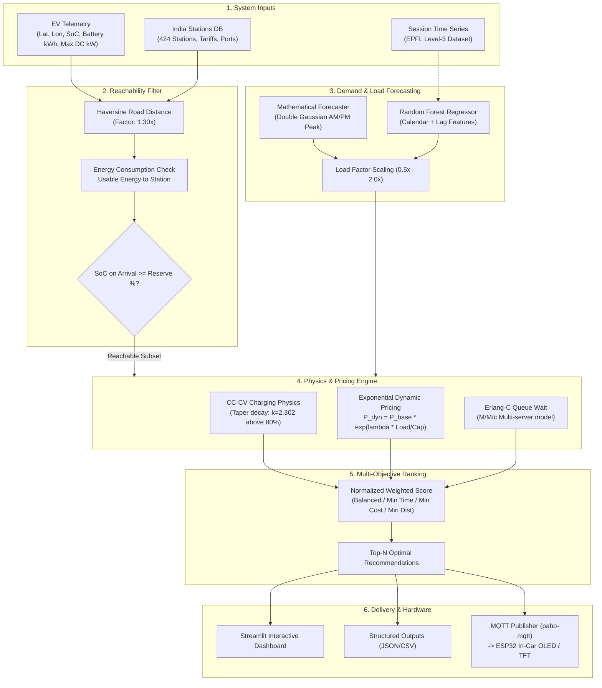

# ⚡ EV Charging Recommendation & Prediction System

[](https://www.python.org/)
[](https://streamlit.io/)
[](https://scikit-learn.org/)
[](https://opensource.org/licenses/MIT)
[](https://docs.pytest.org/)

An intelligent, physics-informed Electric Vehicle (EV) charging recommendation and demand-forecasting system tailored for Indian charging infrastructure. Combines **lithium-ion CC-CV charging physics**, **exponential peak-load dynamic pricing**, **Erlang-C queue modeling**, and **dual forecasting engines** (closed-form mathematical + Random Forest ML) with an interactive **Streamlit dashboard** and **ESP32/IoT MQTT integration**.

---

## 📌 Table of Contents
1. [Overview & Problem Statement](#-overview--problem-statement)
2. [Project Objectives](#-project-objectives)
3. [Key Features](#-key-features)
4. [System Architecture](#-system-architecture)
5. [Core Mathematical & Physics Models](#-core-mathematical--physics-models)
   - [CC-CV Lithium-Ion Charging Physics](#1-cc-cv-lithium-ion-charging-physics)
   - [Exponential Peak-Load Dynamic Pricing](#2-exponential-peak-load-dynamic-pricing)
   - [Hard Reachability & Battery Safety Reserve](#3-hard-reachability--battery-safety-reserve)
   - [M/M/c Erlang-C Queue Wait Estimation](#4-mmc-erlang-c-queue-wait-estimation)
   - [Multi-Objective Ranking Formulation](#5-multi-objective-ranking-formulation)
6. [Forecasting Engines](#-forecasting-engines)
   - [Mathematical Closed-Form Forecaster](#a-mathematical-closed-form-forecaster-zero-training)
   - [Random Forest Machine Learning Forecaster](#b-random-forest-machine-learning-forecaster)
7. [Hardware & IoT Integration (ESP32 / MQTT)](#-hardware--iot-integration-esp32--mqtt)
8. [Project Structure](#-project-structure)
9. [Installation & Setup](#-installation--setup)
10. [Usage Guide](#-usage-guide)
    - [Running the Streamlit Dashboard](#1-interactive-streamlit-web-app)
    - [CLI Pipeline Execution](#2-cli-full-pipeline-run)
    - [Single Vehicle Recommendation](#3-cli-single-vehicle-recommendation)
    - [Model Training](#4-model-training)
11. [Verification & Testing](#-verification--testing)
12. [Benchmark & Experimental Results](#-benchmark--experimental-results)
13. [Limitations & Future Roadmap](#-limitations--future-roadmap)
14. [License](#-license)

---

## 🔍 Overview & Problem Statement

As EV adoption accelerates across India, drivers face critical hurdles:
* **Range Anxiety & Stranding Risk**: Recommenders that solely evaluate Euclidean distance often direct low-battery vehicles to stations beyond their physical reach, ignoring payload, terrain, and battery safety buffers.
* **Non-Linear Charging Speeds**: Lithium-ion batteries do not charge at constant speeds. Beyond 80% State of Charge (SoC), chargers transition from Constant Current (CC) to Constant Voltage (CV), where charging rates decay exponentially to prevent lithium plating. Ignoring this causes severe duration underestimates.
* **Charger Queuing & Congestion**: Station occupancy fluctuates dynamically. A 60 kW charger with a 45-minute queue often results in longer total trip times than an unoccupied 30 kW charger slightly farther away.
* **Grid Overloading & Static Pricing**: Fixed tariffs fail to reflect peak electricity demand or incentivize load balancing across suburban and highway charging corridors.

This repository addresses these challenges through a unified optimization pipeline combining physical chemistry, queue theory, dynamic economics, and machine learning.

---

## 🎯 Project Objectives

1. **Enforce Guaranteed Reachability**: Implement a strict battery reserve filter ensuring recommended stations are reachable with $\ge 5\%$ SoC remaining under real driving conditions.
2. **Model Realistic CC-CV Physics**: Numerically integrate the exponential power taper curve for high SoC sessions (80%–100%) rather than relying on flat derating multipliers.
3. **Incentivize Grid Harmony**: Implement peak-load exponential pricing ($P_{\text{dynamic}} = P_{\text{base}} \cdot e^{\lambda \cdot \text{Load}/\text{Cap}}$) factored with charging efficiency penalties.
4. **Offer Dual Forecasting Options**: Support both a zero-data mathematical Gaussian arrival model and a trained Random Forest regressor evaluated on 13,000+ Level-3 charging sessions.
5. **Bridge Software & Embedded Hardware**: Provide an interactive local Streamlit dashboard alongside modular MQTT publishers ready for low-cost ESP32 microcontrollers and in-vehicle displays.

---

## 🚀 Key Features

* **Physics-Informed Charging Simulation**: Accurate minute-by-minute SoC tracking across CC and CV phases.
* **Dynamic Surge Pricing**: Exponential tariff scaling responding to real-time charger load and battery taper inefficiencies.
* **Erlang-C Queue Modeling**: Analytical wait time estimation using multi-server $M/M/c$ queue theory.
* **Configurable Optimization Objectives**:
  - `balanced`: Weighted multi-criteria optimization (distance, travel time, cost, wait time, load).
  - `min_distance`: Nearest reachable charger first.
  - `min_cost`: Lowest total session cost first.
  - `min_time`: Lowest total journey duration ($\text{travel} + \text{queue wait} + \text{charging}$).
* **Real Indian Station Dataset**: Geospatial queries over 424 validated stations across major Indian cities (Bhopal, Delhi, Mumbai, Pune, Bengaluru, etc.).
* **Rich Web Dashboard**: Built with Streamlit featuring Altair power curves, time-split bar charts, station pricing heatmaps, and GPS route maps.
* **IoT Hardware Readiness**: Dedicated `MQTTPublisher` sending recommendation summaries and stepwise CC-CV profiles to topics like `ev/recommendation` and `ev/charging_profile`.

---

## 🏗 System Architecture



---

## 📐 Core Mathematical & Physics Models

### 1. CC-CV Lithium-Ion Charging Physics

Lithium-ion batteries accept high current during the **Constant Current (CC)** phase. Once cell voltage reaches nominal maximum (typically at 80% SoC), charging switches to the **Constant Voltage (CV)** phase where current exponentially decays to prevent lithium dendrite formation:

$$P(\text{SoC}) = \begin{cases} 
P_{\text{cc}} & \text{for } \text{SoC} \le \text{SoC}_{\text{taper}} \\
P_{\text{cc}} \cdot \exp\left(-k_{\text{taper}} \cdot \frac{\text{SoC} - \text{SoC}_{\text{taper}}}{100 - \text{SoC}_{\text{taper}}}\right) & \text{for } \text{SoC} > \text{SoC}_{\text{taper}}
\end{cases}$$

Where:
* $P_{\text{cc}} = \min(P_{\text{station}}, P_{\text{car\_max\_dc}})$ is the rated DC charging power.
* $\text{SoC}_{\text{taper}} = 80\%$ is the transition threshold.
* $k_{\text{taper}} = \ln(10) \approx 2.302$ ensures power scales down to $\approx 10\%$ of rated capacity at 100% SoC.

Total charging time is evaluated via numerical SoC-domain integration:

$$T_{\text{charge}} = \int_{\text{SoC}_{\text{arrival}}}^{\text{SoC}_{\text{target}}} \frac{\text{Battery}_{\text{kWh}}}{100 \cdot \eta_{\text{charger}} \cdot P(\text{SoC})} \, d\text{SoC}$$

---

### 2. Exponential Peak-Load Dynamic Pricing

To prevent station congestion during peak hours, dynamic electricity tariffs scale exponentially with utilization:

$$P_{\text{dynamic}} = P_{\text{base}} \cdot \exp\left(\lambda \cdot \frac{\text{Current Load}}{\text{Station Capacity}}\right)$$

Where $\lambda \ge 0$ is the price surge sensitivity parameter.

To reflect the wall-plug inefficiency of extended CV charging, the **effective price per kWh** is weighted over the charging window:

$$P_{\text{effective}} = P_{\text{dynamic}} \cdot \frac{1}{\text{SoC}_{\text{target}} - \text{SoC}_{\text{arrival}}} \int_{\text{SoC}_{\text{arrival}}}^{\text{SoC}_{\text{target}}} \frac{P_{\text{cc}}}{P(\text{SoC})} \, d\text{SoC}$$

---

### 3. Hard Reachability & Battery Safety Reserve

Given vehicle consumption $c$ (kWh/km) and drivetrain efficiency $\eta_{\text{drive}}$, road distance $D = 1.30 \cdot D_{\text{haversine}}$. Energy required is:

$$E_{\text{trip}} = \frac{D \cdot c}{\eta_{\text{drive}}}$$

Arrival SoC is calculated as:

$$\text{SoC}_{\text{arrival}} = \text{SoC}_{\text{current}} - \frac{E_{\text{trip}}}{\text{Battery}_{\text{kWh}}} \times 100$$

A station is strictly discarded if:

$$\text{SoC}_{\text{arrival}} < \text{SoC}_{\text{reserve}} \quad (\text{default: } 5.0\%)$$

---

### 4. M/M/c Erlang-C Queue Wait Estimation

For a charging station with $c$ chargers, average service time $T_{\text{service}}$, and utilization factor $\rho = \frac{\text{Load}}{100 \cdot c}$ (capped at 0.90 to reflect driver balking):

$$P_{\text{wait}} = \frac{\frac{(c\rho)^c}{c!(1-\rho)}}{\sum_{k=0}^{c-1}\frac{(c\rho)^k}{k!} + \frac{(c\rho)^c}{c!(1-\rho)}}$$

$$\text{Wait Time} = \min\left(\frac{P_{\text{wait}} \cdot T_{\text{service}}}{c(1 - \rho)}, \; 60\text{ mins}\right)$$

---

### 5. Multi-Objective Ranking Formulation

Metrics are normalized across candidates using Min-Max scaling:

$$\tilde{x}_i = \frac{x_i - \min(x)}{\max(x) - \min(x)}$$

In `balanced` mode, stations are ranked by minimizing:

$$\text{Score} = w_{\text{dist}} \tilde{D} + w_{\text{travel}} \tilde{T}_{\text{travel}} + w_{\text{cost}} \tilde{C}_{\text{cost}} + w_{\text{wait}} \tilde{T}_{\text{wait}} + w_{\text{load}} \tilde{L}_{\text{load}}$$

Default weights: $w_{\text{dist}} = 0.25$, $w_{\text{travel}} = 0.15$, $w_{\text{cost}} = 0.30$, $w_{\text{wait}} = 0.15$, $w_{\text{load}} = 0.15$.

---

## 📊 Forecasting Engines

The system provides two interchangeable forecasting options:

### A. Mathematical Closed-Form Forecaster (Zero Training)
Models EV arrivals using a double-Gaussian diurnal curve modulated by weekend and seasonal factors:

$$\lambda(h) = \left[ A_{\text{AM}} \cdot e^{-\frac{(h - \mu_{\text{AM}})^2}{2\sigma_{\text{AM}}^2}} + A_{\text{PM}} \cdot e^{-\frac{(h - \mu_{\text{PM}})^2}{2\sigma_{\text{PM}}^2}} \right] \times W_{\text{weekend}} \times S_{\text{season}}$$

* **Commute Peaks**: $\mu_{\text{AM}} = 08:00$ ($\sigma = 1.5$h), $\mu_{\text{PM}} = 18:00$ ($\sigma = 2.0$h).
* **Weekend Attenuation**: $W_{\text{weekend}} = 0.65$.
* **Seasonal Modulation**: $\pm 15\%$ cosine oscillation peaking in Indian winter EV travel months.

### B. Random Forest Machine Learning Forecaster
Trained on 13,236 Level-3 fast-charging sessions from the EPFL dataset using chronological 80/20 train/test evaluation (no shuffling).

* **Features**: Hour, day-of-week, month, weekend indicator, sine/cosine cyclical hour encodings, lag features ($\text{lag}_1, \text{lag}_{24}, \text{lag}_{168}$), and rolling averages (24h, 168h).
* **Targets**:
  1. `arrivals_per_hour`: Used to compute dynamic load scaling factor $\in [0.5, 2.0]$.
  2. `duration_min`: Occupancy duration predictor.
  3. `energy_kwh`: Delivered energy per session.

---

## 🔌 Hardware & IoT Integration (ESP32 / MQTT)

The project includes an out-of-the-box MQTT bridge via `paho-mqtt` in `main.py`:

```python
from main import MQTTPublisher

publisher = MQTTPublisher(host="192.168.1.42", port=1883)
publisher.publish_recommendation(recommendation_result)
publisher.publish_cc_cv_profile(charging_profile)
```

### Published Topics & Payloads:
* **`ev/recommendation`**: Real-time optimal station guidance:
  ```json
  {
    "station_name": "ChargeZone Bhopal #11",
    "city": "Bhopal",
    "distance_km": 7.69,
    "charging_time_min": 63.66,
    "charging_cost_inr": 494.05,
    "dynamic_price_per_kwh": 15.52,
    "load_factor": 1.0,
    "soc_arrival": 6.79
  }
  ```
* **`ev/charging_profile`**: Stepwise telemetry streaming (30s intervals) for animated in-car SoC progress bars and power gauges:
  ```json
  {"t_s": 120.0, "soc_pct": 24.3, "power_kw": 50.0, "phase": "CC"}
  ```

---

## 📂 Project Structure

```
ev_charging_recommender/
├── data/
│   ├── india_charging_stations.csv   # 424 verified Indian stations with tariffs & ports
│   └── epfl_l3_sessions.csv          # 13,236 real-world Level-3 DC charging sessions
├── models/
│   └── .gitkeep                      # Trained .joblib models generated via main.py train
├── outputs/
│   ├── metrics.json                  # Model validation metrics (MAE, RMSE, R²)
│   ├── pipeline_results.json         # End-to-end scenario summaries
│   ├── pipeline_ranked.csv           # Consolidated ranking output across scenarios
│   ├── dynamic_pricing.csv           # 424-station pricing report with surge values
│   ├── cc_cv_profiles.json           # Stepwise CC-CV power profiles
│   └── math_forecast_24h.csv         # 24-hour mathematical arrival forecasts
├── src/
│   ├── __init__.py
│   ├── charging_physics.py           # CC-CV integration, taper formulas, power profiles
│   ├── dynamic_pricing.py            # Exponential pricing & Gaussian math forecaster
│   ├── ev_data.py                    # EVState dataclass, IoT JSON parsing, simulators
│   ├── forecasting.py                # Random Forest training, feature extraction, evaluation
│   ├── geo.py                        # Vectorized Haversine distance calculations
│   ├── ranking.py                    # Metric assignment, Erlang-C wait time, scoring
│   ├── reachability.py               # Energy calculations & safety reserve filters
│   ├── recommender.py                # End-to-end recommendation pipeline orchestrator
│   ├── stations.py                   # Station loading, fuzzy column alias resolver, spatial filter
│   └── synthetic.py                  # Synthetic generator fallback for demo sessions
├── tests/
│   ├── test_core.py                  # Reachability, Erlang-C, Haversine, ordering tests
│   └── test_physics_and_pricing.py   # CC-CV physics, taper decay, dynamic pricing tests
├── .gitignore                        # Git exclusion rules (cache, venv, large models)
├── app.py                            # Full-featured Streamlit interactive web dashboard
├── config.py                         # Central configuration parameters & file paths
├── main.py                           # CLI interface & MQTT publisher
└── requirements.txt                  # Production dependencies
```

---

## ⚙️ Installation & Setup

### Prerequisites
* Python 3.10+ (Tested on Python 3.12)
* Git

### Step-by-Step Installation
```bash
# 1. Clone repository
git clone https://github.com/Dhruv-art-npc/ev-charging-recommender.git
cd ev-charging-recommender

# 2. Create and activate a virtual environment
python -m venv venv

# Windows:
venv\Scripts\activate
# Linux / macOS:
source venv/bin/activate

# 3. Install dependencies
pip install -r requirements.txt
```

---

## 💻 Usage Guide

### 1. Interactive Streamlit Web App
Launch the local web dashboard:
```bash
streamlit run app.py
```
Open `http://localhost:8501` to access:
* **EV Parameter Controls**: Adjust latitude, longitude, current SoC, target SoC, vehicle battery capacity, and connector type.
* **Dynamic Pricing Sliders**: Experiment with surge sensitivity $\lambda$ and price caps.
* **Interactive Charts**: Altair CC-CV power curves, phase breakdown donuts, arrival forecast comparisons, and station pricing heatmaps.
* **Live Map**: Visual representation of the EV and reachable charging locations.

---

### 2. CLI Full Pipeline Run
Execute a complete batch pipeline across 4 representative Indian EV driving scenarios:
```bash
python main.py run-pipeline
```
Outputs are automatically written to `outputs/`:
* `pipeline_results.json`: Scenario recommendation summaries.
* `pipeline_ranked.csv`: Complete ranking tables.
* `dynamic_pricing.csv`: Dynamic tariff surge table across all 424 stations.
* `cc_cv_profiles.json`: Stepwise charging power profiles.
* `math_forecast_24h.csv`: 24-hour mathematical arrival forecast.

---

### 3. CLI Single Vehicle Recommendation
```bash
# Minimum distance objective
python main.py recommend --lat 23.2599 --lon 77.4126 --soc 15 --target 80 --objective min_distance

# Balanced objective with CCS2 connector filter
python main.py recommend --soc 20 --target 90 --connector CCS2 --objective balanced

# Custom dynamic pricing sensitivity
python main.py recommend --soc 10 --target 85 --lambda-load 1.5

# IoT JSON string input
python main.py recommend --json '{"lat":23.26,"lon":77.41,"battery_kwh":40,"soc":15,"target_soc":80}'

# Stream recommendations to an ESP32 over MQTT
python main.py recommend --soc 15 --target 85 --mqtt-host 192.168.1.42 --mqtt-port 1883
```

---

### 4. Model Training
Train Random Forest regressors on the EPFL dataset:
```bash
python main.py train
```
Trains arrival, session duration, and energy prediction models and outputs evaluation metrics to `outputs/metrics.json`.

---

## 🧪 Verification & Testing

The project includes 17 automated unit tests covering geometry, reachability, CC-CV physics, queue math, and dynamic pricing:

```bash
pytest tests/ -v
```

### Test Suite Execution Output:
```
tests/test_core.py::test_haversine_bhopal_indore PASSED                 [  5%]
tests/test_core.py::test_range_10pct PASSED                             [ 11%]
tests/test_core.py::test_low_battery_removes_far_stations PASSED        [ 17%]
tests/test_core.py::test_all_objectives_respect_constraint PASSED       [ 23%]
tests/test_core.py::test_objective_ordering PASSED                      [ 29%]
tests/test_core.py::test_unreachable_message PASSED                     [ 35%]
tests/test_core.py::test_validation PASSED                              [ 41%]
tests/test_core.py::test_erlang_c_monotonic PASSED                      [ 47%]
tests/test_physics_and_pricing.py::test_cv_power_kw_constant_current_phase PASSED [ 52%]
tests/test_physics_and_pricing.py::test_cv_power_kw_exponential_taper PASSED [ 58%]
tests/test_physics_and_pricing.py::test_cc_cv_charging_time PASSED      [ 64%]
tests/test_physics_and_pricing.py::test_integrate_cc_cv_kwh PASSED      [ 70%]
tests/test_physics_and_pricing.py::test_cc_cv_power_profile PASSED      [ 76%]
tests/test_physics_and_pricing.py::test_exponential_load_pricer_monotonic PASSED [ 82%]
tests/test_physics_and_pricing.py::test_exponential_load_pricer_cap PASSED [ 88%]
tests/test_physics_and_pricing.py::test_effective_cost_taper_penalty PASSED [ 94%]
tests/test_physics_and_pricing.py::test_mathematical_arrival_forecaster PASSED [100%]

============================= 17 passed in 1.00s =============================
```

---

## 📈 Benchmark & Experimental Results

### 1. Machine Learning Validation (from `outputs/metrics.json`)
Evaluated on an 80/20 chronological split across 13,236 charging sessions (2,116 hold-out test rows):

| Model / Target | Test MAE | Test RMSE | $R^2$ Score | Baseline Comparison |
|---|---|---|---|---|
| **Arrival Forecaster (Random Forest)** | **0.9537 arrivals/h** | **1.3171** | **0.3767** | Outperforms Same-Hour Yesterday ($R^2 = -0.20$) & Last Week ($R^2 = -0.03$) |
| **Session Duration Predictor** | **3.7600 mins** | **4.6086 mins** | **0.7323** | Baseline Historical Mean MAE: 7.29 mins |
| **Session Energy Predictor** | **4.2028 kWh** | **5.4795 kWh** | **0.7414** | Baseline Historical Mean MAE: 8.83 kWh |

**Top Feature Importances (Arrival Model):**
* `hour_cos` (0.3363)
* `roll_168` (0.1494)
* `roll_24` (0.1080)
* `hour_sin` (0.0789)
* `month` (0.0606)

---

## 📄 License

This project is licensed under the [MIT License](LICENSE).
